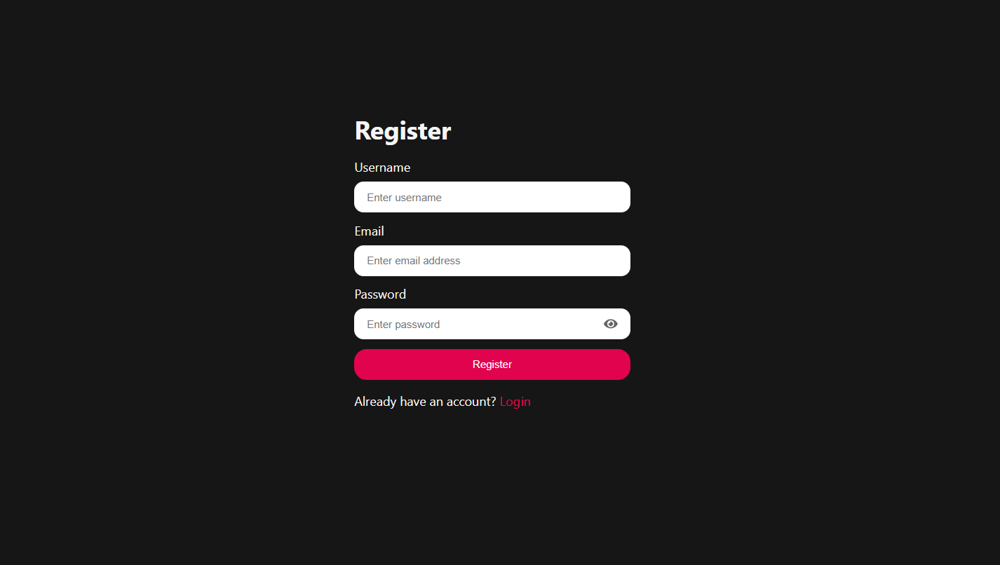
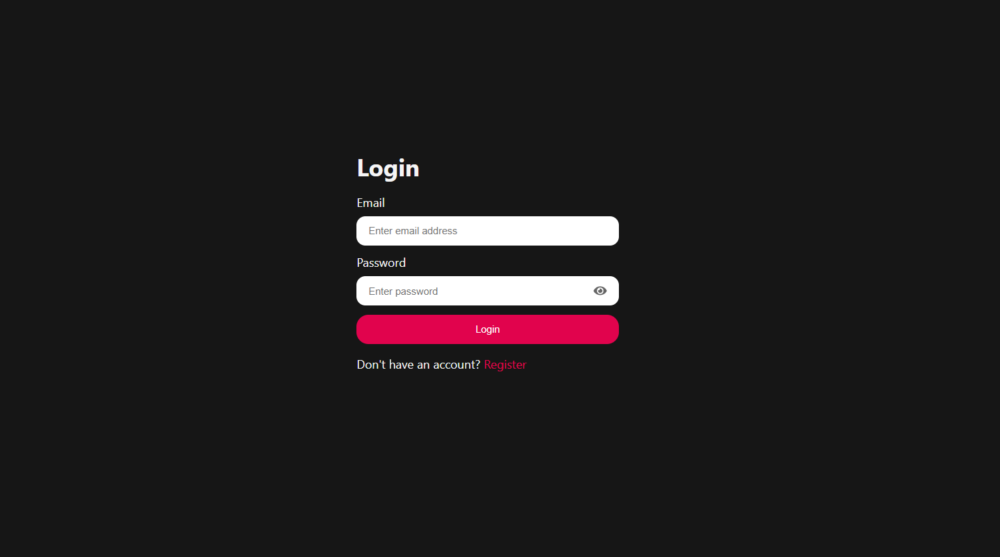
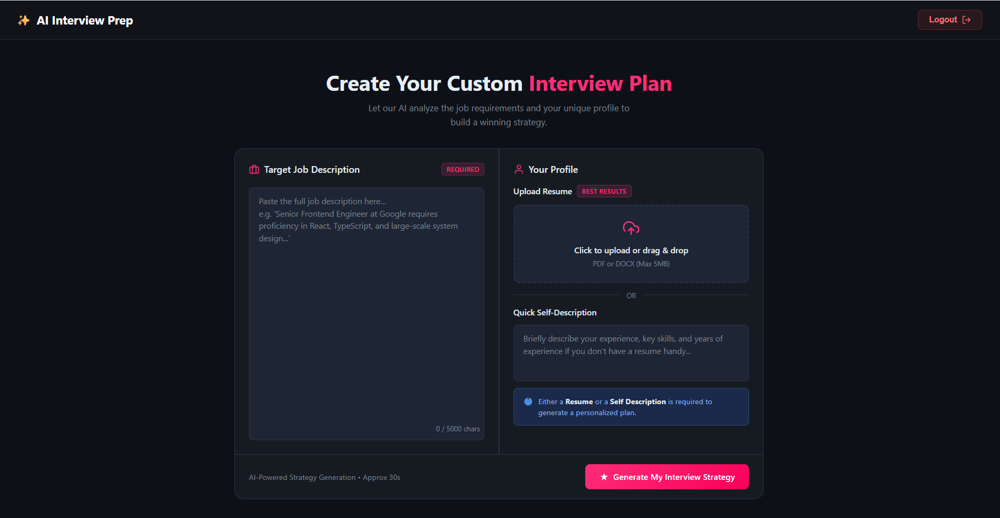
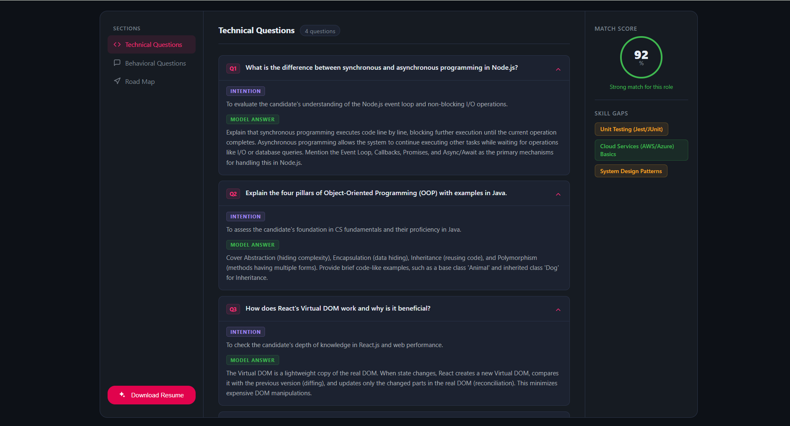
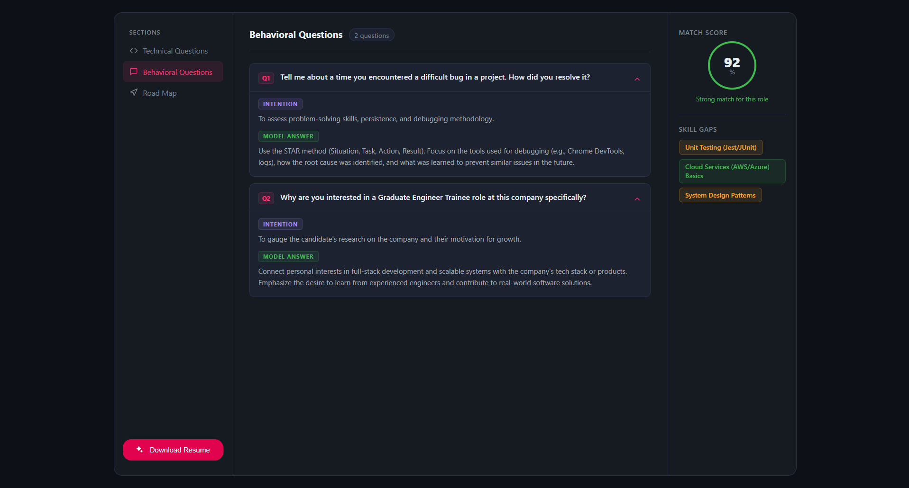
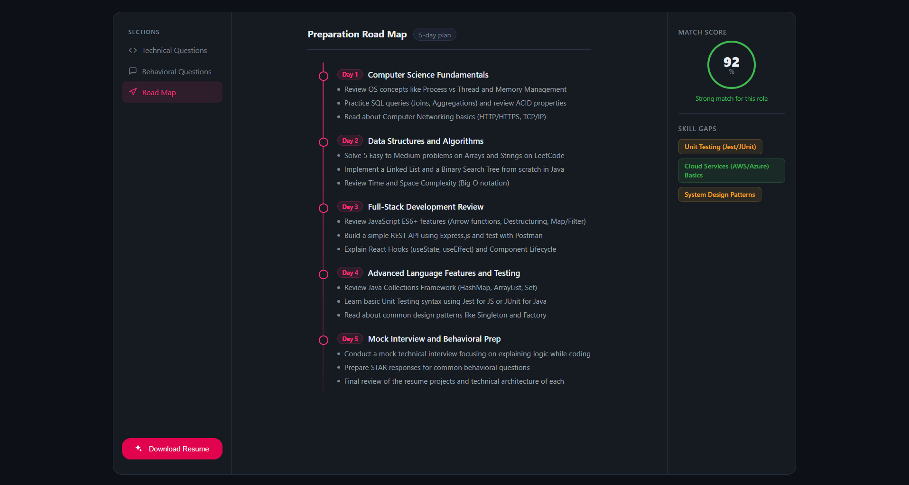
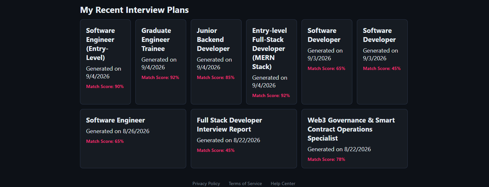
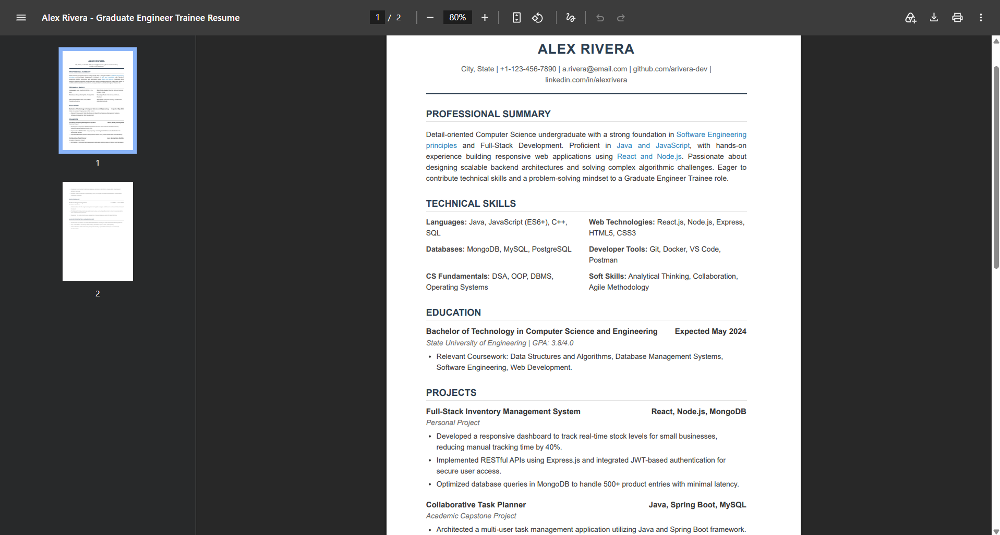

# AI-Powered Interview Preparation Platform 🚀

A full-stack MERN application designed to help job seekers prepare for technical interviews using Google Gemini AI. It offers dynamic question generation, customized roadmaps, skill gap analysis, and secure user authentication.

---

## 🛠 Tech Stack

**Frontend:**
* React.js (Vite)
* SCSS / CSS
* React Router DOM

**Backend:**
* Node.js & Express.js
* MongoDB (Mongoose ORM)
* JSON Web Tokens (JWT) for Authentication

**AI Integration:**
* Google GenAI API (Gemini Model)

---

## ✨ Features

* **Customized Preparation Roadmaps:** Generates step-by-step day-wise preparation plans tailored to target job roles.
* **Match Score & Skill Gap Analysis:** Analyzes candidate profile against job descriptions to provide compatibility scores and highlight missing skills.
* **Domain-Specific Mock Questions:** Generates targeted Technical and Behavioral interview questions with AI guidance.
* **Downloadable Resume & Reports:** Export customized preparation summaries, AI feedback, or resume insights directly.
* **Real-time Feedback & Evaluation:** Evaluates candidate answers using Gemini AI to provide instant ratings and actionable advice.
* **Resume Processing & Parsing:** File handling and profile parsing via backend middleware.
* **Secure Authentication:** Complete JWT-based registration, login, and route protection.

---

## 📸 Application Screenshots

### 🔑 Authentication
| Register Page | Login Page |
| --- | --- |
|  |  |

### 🎯 Strategy Generator & Technical Prep



### 🗓️ Behavioral Questions & Roadmap



### 📄 Dashboard & Resume Preview



---

## 📂 Project Architecture & Folder Structure

```text
ai-interview-prep/
├── Backend/
│   └── src/
│       ├── config/
│       ├── controllers/
│       ├── middlewares/
│       ├── models/
│       ├── routes/
│       └── services/
│
├── Frontend/
│   └── src/
│       ├── assets/
│       ├── features/
│       └── style/
│
├── .gitignore
└── README.md